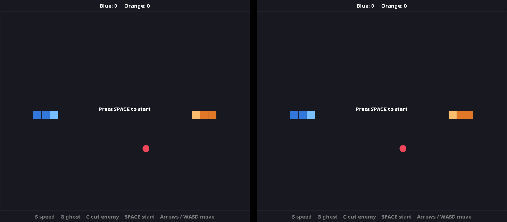
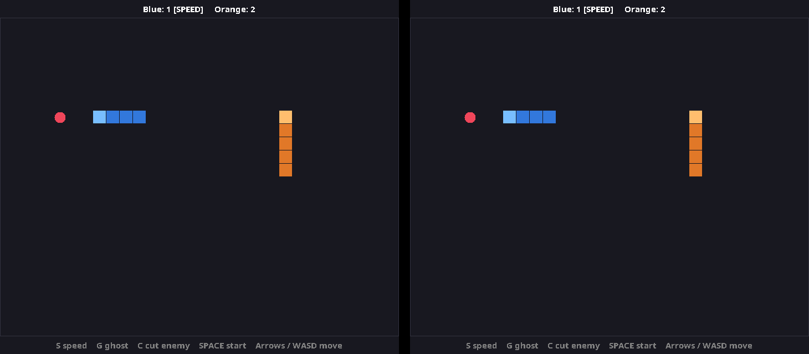
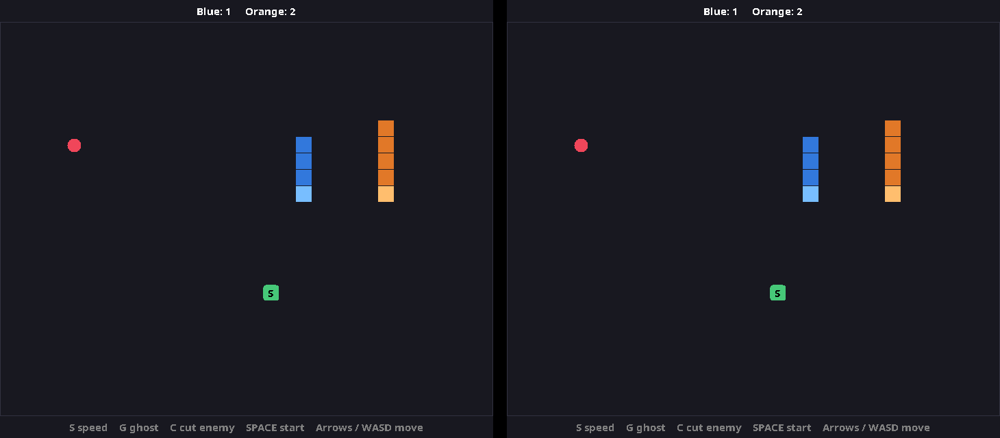
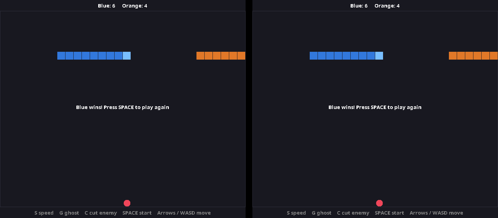

# Snake Duel

Two players, two laptops, same Wi-Fi. Needs Java 11 or newer on both.

**Both laptops:** copy this folder over, open a terminal in it, and compile:

    javac --release 11 *.java

**Laptop 1 (host):**

    java Main

The window shows the command for the other player, with your IP in it.

**Laptop 2:**

    java Main <host-ip>

If it can't connect, allow port 5555 through the host's firewall.

## How to play

- Arrows or WASD move along the X and Y axes. SPACE starts a round.
- Red dot is the one reward: +1 point and you grow.
- Hit a wall, yourself or the other snake and you lose.
- Green tiles are power-ups that appear at random for a few seconds:
  - **S** Speed: move twice as fast for 6 seconds
  - **G** Ghost: pass through snakes and walls for 6 seconds
  - **C** Cut: chop the other snake's length

## Screenshots

Blue's laptop is on the left, Orange's on the right.

**Ready to start**

**Mid-game**

**A power-up on the board**

**Round over**

## Code

| File | Job |
| --- | --- |
| `Direction` | The four moves on the X and Y axes |
| `Snake` | One snake: turn, move, grow, shrink |
| `PowerUp` | Each power-up's effect |
| `Game` | The rules; runs on the host only |
| `Board` | The window: draws state, reads keys |
| `Main` | Networking: host or join |
